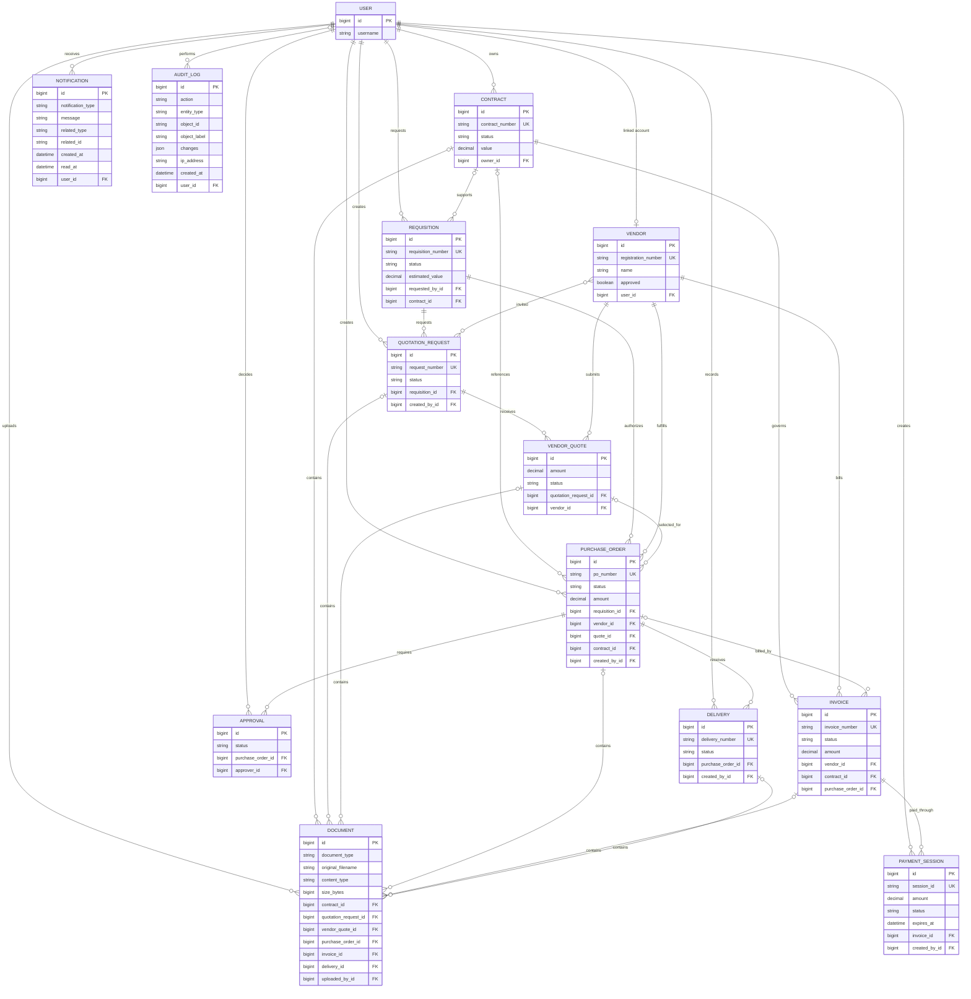

# ContractCommand entity relationship diagram

`USER` represents Django's configured user model. `VENDOR.user_id` is nullable
and one-to-one. `INVOICE.purchase_order_id`, `PURCHASE_ORDER.quote_id`, and
`PURCHASE_ORDER.contract_id` are nullable. Each approval is unique per
purchase-order/approver pair, and each vendor may submit at most one quote per
quotation request. A document must reference exactly one supported business
record; its file is stored in private filesystem storage and downloaded only
through the authorized API. Audit-log entity references are descriptive rather
than foreign keys so history remains after business records are deleted.
